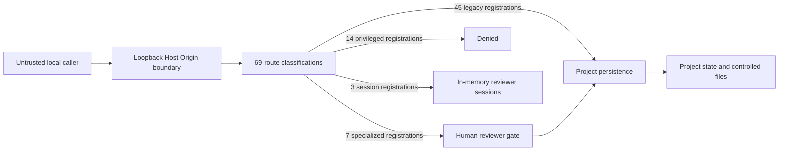
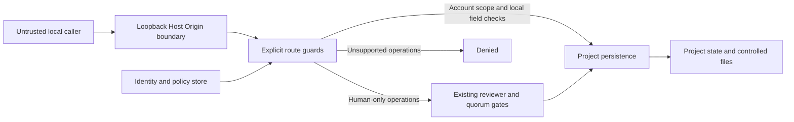
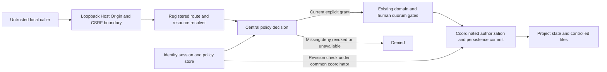
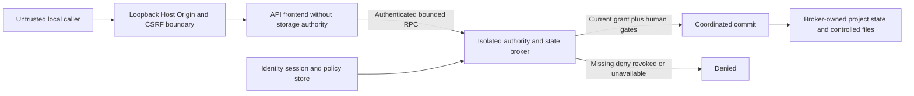

# Security Hardening Proposal: Authenticated project and resource authority

## Decision

**PROPOSED / HUMAN DESIGN REVIEW REQUIRED.** We have verified PR #46's containment and post-merge CI; we have not implemented this proposal. We must retain its 14 disabled registrations, loopback-only binding, origin checks and all human-governance protections. Approval of this document would select a design, not enroll people, register DMK tasks, activate credentials or execute Gate 7.

## Executive Recommendation

The options are **Option 1: authenticated route-local guards** (`local-guards`), **Option 2: a central in-process policy service with local resource enforcement** (`central-policy`), and **Option 3: an isolated authority and state broker** (`isolated-broker`). I recommend Option 2 for the current single-process, local application. It gives us one permission contract and a testable commit boundary without immediately moving the data plane into another service.

We should choose Option 1 if the protected API becomes small and effectively frozen, with a team willing to own every local guard. Option 3 becomes preferable if mutually untrusted code, multiple OS users or shared operation make process isolation an immediate requirement. Neither condition has been established here. The [bounded implementation sequence](../implementation/central-policy.md) is a proposal requested by the operator, not a selected or authorized implementation.

## Evidence

I inspected the actual main server, identity/signoff/proposal/document registrations and persistence interceptor at `f35fa7bcd9fb00942c1bba76741a22a5cc7c80b8`. I also ran the real server in disposable fixtures. The package-overwrite and server-attribution observations most strongly motivate moving authority ahead of persistence.

| Evidence | Title | What it establishes |
| --- | --- | --- |
| E-ROUTES | [69-route source inventory](../route-authorization-gaps.md) | 45 unscoped, 14 blocked, 7 specialized and 3 session registrations; all methods/paths reproduced independently |
| E-PROBE | [Actual-server characterization](../evidence/characterization.log) | Anonymous selected-project reads/writes, resealed overwrite, claimed audit actors and reviewer reads without membership; retained denials also reproduced |
| E-IDENTITY | Reviewer identity and quorum sources | `server/proposals/identity.ts` uses an operator roster and in-memory sessions; `signoff.ts` preserves HUMAN authority and distinct role quorum, not project membership |
| E-PERSIST | Persistence and document sources | `server/projectPersistence.ts` intercepts successful mutations, including some nominally read-only POSTs; controlled files use a separate coordinated journal |
| E-MERGE | [PR #46 merge, review and CI](https://github.com/Jeruzael/docmonstakrakin/pull/46) | Final-head pre-merge approval and exact-merge 65/65 post-merge CI; no general authentication implementation |
| E-PLAN | Existing ownership and Agent Center designs | `docs/00_control/LOCAL_AUTH_WBS_OWNERSHIP_CANDIDATE.md`, PR #34 head `5912185a005df3e0469dd46392d7d0dbb0378b68`, and Agent Center v0.3 retain separate ownership and blocked live execution |

E-ROUTES, E-PROBE, E-IDENTITY and E-PERSIST are observed source/experiment facts. We infer that authority is dispersed or absent at the project boundary; that inference does not assert a new bypass of the existing disabled groups. All designs, permissions, lifetimes and storage changes below are proposed. The [evidence manifest](../evidence-manifest.json) binds 16 source/captured items; no sealed scan or approved governance receipt is asserted.

## Current Design And Failure Mode

The network boundary decides whether a request is a permissible local transport. It cannot decide which person or process owns project B. The legacy handler then chooses B's collection directly from a URL or imported package ID. A successful response can persist data and an audit entry even when the actor label came from the request.

We can see the distinction in package import: integrity checks and governance downgrades remain valuable, but a caller can generate another valid envelope. Its seal provides no permission to replace the destination. Similarly, a hash chain containing a supplied author label is not an authenticated human statement.

The specialized reviewer context is a different authority plane. We must add scope around it, rather than converting every eligible reviewer into a universal administrator or weakening quorum. Existing requirement state validation also needs its own targeted repair (AZ-08); a policy service alone cannot make invalid business states valid.

## Desired Invariants

- Every non-public operation requires a current authenticated principal, a server-registered action, a canonical resource and an explicit grant. Explicit deny, unknown policy and unavailable authority all deny.
- Workspace creation/listing, project membership, content access, project administration and human governance are separate capabilities. No display owner, roster role, model name, package field or loopback connection grants another capability.
- Route IDs, nested reference IDs, package destinations and source-document ACLs are bound to the resolved project before sensitive reads, snapshot entry, journal preparation or writes.
- A coordinated commit rechecks the authority revision and state digest. A concurrent revocation cannot be acknowledged and then ignored by a later commit.
- Human-only approval remains nondelegable. Agent principals cannot count toward Security Officer/Lead Architect quorum, including through custom roles or parent delegation.
- Audit provenance identifies server-resolved principal kind, stable ID, session/delegation reference, resource, action and policy version. Imported labels remain explicitly unverified historical content.
- Denial leaves project state, evidence ledger, documents, vault and Git unchanged. Bounded authentication/security telemetry is separate from business evidence.
- Derived context/export must satisfy the intersection of every contributing source ACL and current denies, including discovery restrictions, following Agent Center v0.3. A citation list alone is insufficient.

## Constraints And Non-Goals

We will not infer governance authority from GitHub approval of PR #46. PR #34 remains unmerged; DMK-209–214 are proposed ownership only. DMK-197 owns the existing inbox/quorum; DMK-198 owns reviewer provisioning UX; DMK-206 owns evidence-bound WorkItem adjudication; DMK-208 retains canonical lifecycle ownership. This proposal creates no duplicate canonical tasks.

No remote binding, provider trust, live agent worker, credentials migration, signer enrollment, WBS reconciliation or release action is activated. Existing single-process rollback/recovery guarantees and immutable historical bytes must survive. No latency, memory or deployment budget was supplied; estimates below are source-derived mechanisms, not measurements.

## Before Architecture

The current path deliberately separates transport containment from the missing project authority:

The 3 reviewer session registrations support their existing specialized plane. They do not supply accounts, membership or permissions for the 45 legacy registrations.

## Options

### Option 1: Authenticated route-local guards

We can introduce a shared human/session store, then put account, project and resource checks beside each handler. This preserves the immediate visibility of each business rule and may be proportionate for a stable API. Each team can check the exact IDs its handler dereferences without building a general policy language.

The cost appears when one operation touches several authorities: package destination replacement, source ACL intersection, controlled repository files and human approvals must each agree on grant semantics. Repeating these rules makes future route additions and aliases harder to review. It is still a serious option if we require a closed route matrix, shared helper contracts and actual-entrypoint tests rather than accepting ad hoc checks. Revocation/commit ordering remains a cross-cutting coordination problem even with local guards.

| Change | Before | After | Security consequence | Cost |
| --- | --- | --- | --- | --- |
| Authority placement | Legacy handlers have no membership | Each route resolves principal and scope | Existing gaps can be repaired; consistency depends on every caller | Repeated checks and review burden |
| Commit | Snapshot wrapper precedes general auth | Each route must authorize before entering it and recheck at commit | Prevents pre-denial effects if uniformly applied | Refactoring registrations and transaction entry |

Identity/session lookup and repeated grant reads add work on each request; per-route caches can reduce it but increase invalidation risk. Memory grows with accounts, sessions and grants, not with a new service. One failing auth store blocks protected routes while health/login remain separately classified. Migration can proceed by coherent route families; rollback must disable those families rather than restore anonymous access. We should measure permission calls and audit every new registration for drift.

### Option 2: Central policy service with resource enforcement

We can keep the application process while moving decisions into one owned service: `authorize(principal, action, canonicalResource, context)`. Route metadata selects an action; resource resolvers establish project/document/package ownership; existing endpoint validators and human quorum remain additional checks. This is scoped capability/relationship enforcement, not a role-name-only switch.

The important boundary is the transaction. We would authenticate and authorize before calling the current persistence interceptor, then use a shared authorization/persistence coordinator to serialize policy updates and sensitive commits. The coordinator rechecks policy revision and project snapshot digest before publishing state. Offline administration must stop the service; it must not write around that coordinator. If we cannot demonstrate this ordering across project JSON, identity storage and document journals, the affected cutover remains blocked.

| Change | Before | After | Security consequence | Cost |
| --- | --- | --- | --- | --- |
| Decision contract | Transport plus route-specific reviewer role | One default-deny principal/action/resource contract | Consistent scope and denial semantics | Registry, resource resolvers and policy tests |
| Resource reads | URL selects an unscoped collection | Authorized project and nested resource handle | Blocks selected-project disclosure and overwrite | Existing handlers must consume resolved scope |
| Commit boundary | Snapshot/journal without general grants | Current policy revision plus state digest under coordinator | Revocation and stale-state races fail closed | Cross-store coordination and crash tests |
| Attribution | Static or supplied actor labels | Server principal plus policy provenance | Future events distinguish identity from untrusted metadata | Versioned event fields; preserve old evidence |

#### Human identities, bootstrap and credentials

We propose stable HUMAN principal IDs and a private per-OS-user security store outside Git and ProjectStore/package data. A transactional SQLite-backed repository is the target, subject to a reviewed Node 22-compatible binding; do not depend silently on an experimental runtime API. Only the server/coordinator writes it. OS file permissions, backup encryption and recovery lock checks are part of acceptance, not consequences of choosing SQLite.

Initial enrollment is an explicit offline local-operator ceremony with no open HTTP registration or default password. It creates a workspace bootstrap administrator only; project grants and Security Officer/Lead Architect roles require separately attributable authorized decisions. Account recovery uses a documented offline ceremony, invalidates existing sessions and does not manufacture a second human. Existing roster and signer IDs require an explicit reviewed mapping; no migration is run by this proposal, and no application session becomes a cryptographic WBS signature.

Verifiers carry algorithm, parameters, random salt and version. We recommend a reviewed Argon2id profile with a starting minimum of 19 MiB, two iterations and parallelism one, then workstation benchmarking; a separately approved scrypt profile is an alternative when that dependency is unsuitable, never an automatic weak fallback. Raw passwords, session tokens and recovery material never enter packages, repository files, audit payloads or logs. KDF work must be asynchronous and concurrency-bounded, with generic errors and bounded per-account/source/global throttles so shared loopback traffic cannot cheaply monopolize the process. Upgrade old verifiers only after authorized migration and genuine reauthentication. [OWASP password-storage guidance](https://cheatsheetseries.owasp.org/cheatsheets/Password_Storage_Cheat_Sheet.html) informs the profile choice; hardware costs remain to be measured.

#### Sessions, browser boundary and revocation

We propose opaque random 32-byte session tokens, storing only their digest with principal ID, credential revision, session generation, issue time, 10-minute idle and 30-minute absolute expiry. These lifetimes are review candidates, not current settings. Rotate on authentication/elevation; revoke on logout, disable, password/role change and recovery. Fail closed on authority-store failure. Restart invalidates session generation by default; persistent accounts do not imply persistent login. Only authorized activity extends idle expiry, within the absolute bound.

Browser sessions use host-only HttpOnly, SameSite Strict cookies; state-changing cookie requests require exact approved Origin/Fetch Metadata and a session-bound synchronizer token. Never put bearer credentials in localStorage, URLs or model context. Origin checks and SameSite are complementary to CSRF tokens, not identity. These choices follow the [session](https://cheatsheetseries.owasp.org/cheatsheets/Session_Management_Cheat_Sheet.html) and [CSRF](https://cheatsheetseries.owasp.org/cheatsheets/Cross-Site_Request_Forgery_Prevention_Cheat_Sheet.html) guidance.

**Browser activation has an unresolved transport gate.** Current local HTTP cookies are not a boundary against hostile same-host services; [cookies are not isolated by port](https://www.rfc-editor.org/rfc/rfc6265.html#section-8.5). We recommend a separately reviewed same-origin loopback HTTPS design with protected certificate keys and Secure cookies before persistent browser-authentication cutover. Use a dedicated per-installation authority with no mutually distrusting service sharing that hostname; validate loopback resolution, browser trust and key custody on the supported OS before selecting it. The future transport change must adapt the shared main/dev/preview scheme-aware boundary without adding wildcard hosts, auxiliary listeners or an unsafe override. No trust-root installation, HTTPS listener change or public-network mode is authorized here. A documented HTTP-only threat acceptance would be a separate human decision; it must not be sold as protection against hostile local processes. An attacker with the operator's process/filesystem rights remains outside this application's isolation guarantee even after HTTPS.

#### Permissions and processing order

The proposed permission registry separates workspace administration, filtered project discovery/creation, project membership administration, resource reads/modification, package verify/create-import/replace-import/export, repository operations, secrets administration and agent dispatch. The detailed per-route names in the inventory are candidate contracts. Custom roles may select registered capabilities and restrictions; explicit denies and immutable governance floors win. A workspace administrator receives no automatic project content grant or human governance role.

Processing order is transport and unambiguous route selection; bounded parsing/authentication; current principal and grant lookup; canonical project/resource resolution and authorization; coordinated persistence entry with revision/state recheck; domain/immutable-evidence/quorum validation; atomic state/document/audit commit; authorized-field serialization. Resource existence can be checked internally but cannot be disclosed to a nonmember. New or unsupported route registrations deny rather than falling into a legacy allowance.

During migration, any general session and specialized reviewer session on one request must resolve through an approved one-to-one mapping to the same stable HUMAN principal. Reject missing/conflicting mappings or mixed human/machine credential sources; never combine one person's project grants with another person's reviewer cookie or union their rights. Apply this binding at the first operation that combines both authority planes, not only at final legacy cutover.

An import authorizes the final destination after bounded envelope parsing. New project creation requires workspace create/import permission; replacement additionally requires an explicit grant for the existing target, reviewed replace intent and current destination digest. Envelope IDs cannot redirect an authorized import into another project. Preserve the local audit chain and append an import segment referencing untrusted foreign history; do not adopt its actors, approvals or ACLs as local authority. Export requires source-read plus export permission and inherits source restrictions. Existing governance downgrades remain.

#### Machine identities and future integrations

An AGENT is an independent principal, not a HUMAN with a persona name. GPT, Claude, Gemini and any other provider label supplies no trust. A future delegation is issued by an authorized human for one project/resource/action set, with audience, expiry, policy revision, budget and revocation ID; effective rights are the intersection of delegator, project policy, delegation and source ACLs. Restrict machine credentials to an authenticated orchestration channel; never place them in prompts or let model output choose a credential or claim actor kind.

Secret/Git actions and provider egress require explicit privileged capability and any separately ratified human approval. Human quorum and WBS signing are nondelegable regardless of role or nested grants. Worker transactions, idempotency, classification, consent, uncertain provider outcomes and egress confinement remain owned by the Agent Center v0.3 workstream; authorization readiness does not authorize live execution. Revocation must block new work and recheck queued work before a sensitive boundary.

Central policy adds a lookup and potentially a serialization point; deny-path work remains bounded and must not read entire projects. A database or policy outage deliberately reduces availability of protected operations, so recovery and diagnostic health must remain explicit. Grant/session indexes and caches increase memory; revision-tagged invalidation and tests matter more than premature caching. One process keeps installation and debugging tractable, but does not isolate a compromised server from its files. Cutover by route family and locked compatibility states makes rollback understandable.

### Option 3: Isolated authority and state broker

We could move identity, policy, project data/files and privileged execution into a broker under a separate OS identity. The HTTP frontend would hold neither provider credentials nor direct project-file authority and would make bounded authenticated RPC requests. This becomes attractive when serving multiple OS users or running untrusted integrations: a compromised frontend would have a smaller raw filesystem/credential blast radius.

This is materially more than moving an `authorize` function out of process. If the frontend retains the same filesystem permissions, the new hop provides little isolation. The broker would need ownership of state, document and privileged operation boundaries, OS ACLs, authenticated channel identity, request-size limits, supervision and failure recovery. External model services would still be untrusted callers; they do not gain broker credentials.

| Change | Before | After | Security consequence | Cost |
| --- | --- | --- | --- | --- |
| Data authority | HTTP process owns state/files | Broker owns sensitive storage and commits | OS boundary narrows frontend compromise | Service installation, IPC and file-ownership migration |
| Failure domain | One process | Supervised frontend and broker | Can isolate frontend crashes; broker outage still denies operations | Correlation, backpressure and recovery protocols |

RPC serialization, copies, channel setup and queueing add latency and memory beyond policy evaluation. Split crashes can leave an unknown RPC outcome, so idempotency and evidence binding are mandatory; retries cannot blindly repeat imports or Git commits. Operations must manage two services, certificate/pipe permissions and version skew. Rollout needs a reversible data-ownership migration with the old writer stopped. Rollback cannot restore an overprivileged frontend or anonymous access; an offline safe state may be the only acceptable fallback. I would prefer this option when OS-level multiuser isolation becomes a requirement, after we measure and approve those costs.

## Comparison

These are unmeasured design effects. We can compare mechanisms without inventing a composite score.

| Dimension | Option 1: local guards | Option 2: central policy | Option 3: broker | Basis / validation |
| --- | --- | --- | --- | --- |
| Security | Repairs current paths, more future drift risk | Common default-deny contract and coordinated commits | Same policy plus OS ownership isolation | Source-derived; original negative cases, registration drift, revocation races |
| Performance | Repeated guard/grant lookups | Common lookup and commit serialization | Added IPC/copies/queue | Hypothetical; same-machine authorized/denied read/write/import p50/p95 and saturation |
| Memory | Session/grant state and optional caches | Session/grant indexes, bounded KDF pool | Additional process, IPC buffers and queues | Hypothetical; idle/peak RSS and concurrent login/import workload |
| Reliability | Local guard omission remains possible | Authority-store outage fails closed; common coordinator is critical | Supervision and version-skew/partial RPC failure | Source-derived mechanism; injected crash, disk-full and lock contention |
| Operability | Familiar handlers, many checks to audit | One decision log and policy revision, new private store | Additional service, identities and IPC diagnostics | Hypothetical; install/recover/revoke drills, inspectable denial reasons |
| Migration | Route families change separately | Central cutover, scoped handlers and staged reviewer mapping | Data/file ownership migration and deployment change | Source-derived; fixture migration, restart and rollback rehearsals |
| Developer drift / reversibility | Guard duplication; disable families on rollback | Typed registry and closed registration coverage; restore a safe disabled state | Protocol and OS ACL drift; offline fallback | Source-derived; unknown-route test and old-client compatibility matrix |

We have no measured decision threshold for latency/RSS. Before implementation approval, the owner must choose budgets on the target workstation and compare the current revision with the candidate under identical workloads. A security-preserving rejection is preferable to silently dropping a check to meet a benchmark.

## Recommendation

I recommend Option 2 under the existing local single-process constraints. The observed failures share one missing principal/action/resource boundary; a central policy contract addresses that recurrence condition while allowing the existing domain and evidence safeguards to stay visible. The remaining local-process and cross-store risks should be reviewed directly rather than hidden behind the new component's name.

A small fixed API could justify Option 1. Evidence of untrusted server extensions, shared OS identities or a required compromise boundary would move the decision toward Option 3. None of these designs alone fixes arbitrary requirement statuses, performs approved enrollment or ratifies governance policy.

## Evidence Coverage And Residual Risk

| Evidence / issue | Option 1 | Option 2 | Option 3 | Tactical protection still required |
| --- | --- | --- | --- | --- |
| E-ROUTES — unscoped project routes (AZ-01/02) | addresses if every guard correct | addresses after complete cutover | addresses after complete broker migration | Existing containment; per-resource/field checks |
| E-PROBE — bulk import/export and claimed actors (AZ-03/04) | mitigates | addresses after target/ACL/audit integration | addresses only with broker-owned data boundary | Import downgrades; seal validation; historical actor labels remain unverified |
| E-IDENTITY — unscoped reviewer authority and revocation (AZ-05/07) | mitigates | addresses after mapping and durable revocation | addresses after mapping and broker revocation | Existing HUMAN gate and distinct-role quorum |
| E-PERSIST — file/commit boundary (AZ-06) | mitigates | addresses after coordinator proof | addresses after broker ownership proof | Manifest pins, path containment, snapshot/journal rollback |
| E-PROBE — arbitrary requirement state (AZ-08) | unaffected by auth alone | unaffected by auth alone | unaffected by auth alone | Targeted allowlist/state-machine repair |
| E-MERGE — PR #46 containment and CI | unaffected; retain | unaffected; retain | unaffected until equivalent broker control verified | No reopening of blocked groups by architecture merge |
| E-PLAN — proposed WBS/Agent Center readiness | mitigates future design risk | mitigates future design risk | mitigates future design risk | Separate human decisions, registration and live-worker verification |

The effects are conditional future design coverage, not remediation status. Compromised operator OS access, malicious authorized actors, browser XSS and provider egress still need their own controls. No proposal or passing characterization test closes these issues.

## Migration And Rollout

We should start with identity and decision primitives, then project isolation, packages/sensitive resources, remaining legacy cutovers, privileged administration and finally separately authorized machine operations. Each slice has its own acceptance and rollback gate in the implementation proposal. The first slice cannot claim the 45 legacy routes are protected merely because login exists.

Back up only disposable fixtures during development. A later operator migration requires a reviewed map of principal IDs, existing reviewer identities, credentials, memberships and policy revisions, an encrypted recoverable backup, and an exact authorized cutover. Preserve historical receipts and old audit bytes. Unknown mappings deny; there is no automatic owner fallback.

## Validation Plan

Run tests against actual main/dev/preview entrypoints. Use anonymous, stale/revoked, member, nonmember, project administrator, eligible human reviewer and AGENT principals with disposable credentials. Exercise every registration, method, HEAD/case/trailing-slash/encoded-path form, package destination and nested reference. Confirm legitimate same-project workflows and distinct-human quorum still succeed.

For every denial, compare snapshot/document/vault/Git bytes, journal directories, state versions and business audit counts before and after, including stale snapshots and concurrent policy revocation. Verify the decision occurs before persistence, source-content reads or external calls. Preserve all current 65 suites and the 51/11 boundary checks; new expected 401/403 contracts need positive authorized replacements, not deleted assertions.

## Implementation Work Packages

The [central-policy implementation proposal](../implementation/central-policy.md) contains six bounded slices, dependencies, acceptance, negative tests, compatibility, evidence and rollback. Planning keys S2-A through S2-F are sequencing labels only. Existing DMK ownership is a conditional cross-reference, not assignment or task registration.

## Open Questions

- Approve the central policy option and exact threat boundary, including local HTTPS certificate/bootstrap ownership or a separately stated HTTP threat acceptance.
- Approve private security-store location/binding, KDF profile and measured workstation resource budgets.
- Resolve PR #34's registration/forward-verifier gates and dependency ordering. Do not satisfy DMK-211's dependency on DMK-209 by falsely declaring PR #46 full authorization.
- Approve explicit reviewer/principal mappings, project grants, recovery authority and the unchanged human policy floor before any credential cutover.
- Authorize the first bounded implementation candidate separately after design review; no implementation starts from this document.
