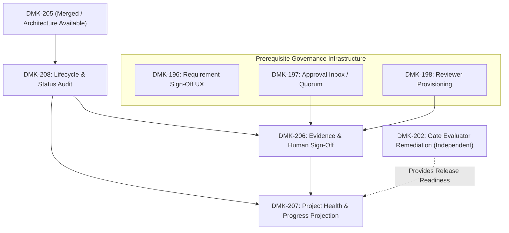
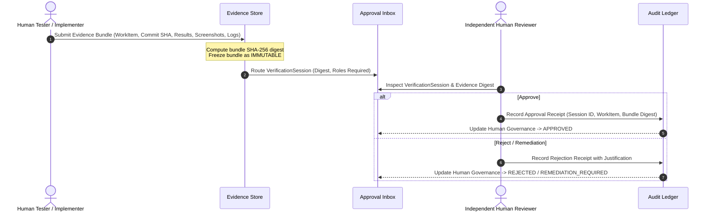

# DOCMONSTAKRAKIN Post-DMK-205 Self-Governance & Progress Program Plan

**Document ID:** PLAN-GOV-2026-001  
**Authority:** Architectural & Governance Program Plan  
**Target Milestone:** v0.1.0 Stabilization & v0.2 Preparation  
**Status:** DRAFT / PENDING HUMAN APPROVAL  
**Author:** Gio (Lead Architect)  
**Date:** 2026-10-04  

---

## 1. Purpose

This program plan formalizes the next phase of self-hosting and governance hardening for DOCMONSTAKRAKIN following the successful implementation and merge of DMK-205 (Canonical WBS → Runtime WorkItem Synchronization). It establishes an architectural framework to transition DOCMONSTAKRAKIN from static bootstrap heuristics into a living, truthful, self-tracking control plane.

Crucially, this architecture establishes and strictly preserves the separation between five distinct dimensions:
1. **Execution Progress** (How much implementation code has actually been written?)
2. **Technical Verification** (Does the test evidence prove the implementation functions correctly?)
3. **Human Governance** (Have authorized independent human sign-offs been formally granted?)
4. **Project Health** (Is the project in a healthy, compliant, and auditable posture?)
5. **Release Authority** (Has formal release gate sign-off been executed under authorized human key?)

These dimensions must never be collapsed or conflated into overloaded lifecycle statuses or static UI badges.

---

## 2. Current Problems

Operational and manual use of DOCMONSTAKRAKIN following DMK-205 revealed three core architectural gaps:

1. **Untruthful Canonical Lifecycle Statuses**:
   - The canonical WBS lifecycle currently lacks an explicit `IN_PROGRESS` status for active work.
   - Certain tasks (e.g. DMK-196) have substantial codebase implementation already present, yet remain classified in `BACKLOG` or `PROPOSED`.
   - Without an explicit evidence-based audit, canonical status does not reflect repository reality.

2. **Overloaded Technical Verification Status**:
   - `VERIFIED` status in the lifecycle is currently ambiguous. It indicates technical test suite passing, but is frequently misconstrued as implying human governance approval.
   - Several historical items (e.g., DMK-187..190, DMK-156..159, DMK-165) are technically verified by automated suites, yet legitimately lack formal human review and approval provenance.
   - Conflating technical verification with human governance creates either false compliance or unresolvable deadlocks.

3. **Stale Bootstrap Health & Progress Placeholders**:
   - The self-project dashboard renders static bootstrap values (e.g., `0%` for implementation, verification, security assurance, and release readiness).
   - Concurrently, the UI displays hardcoded presentation labels such as "On track" and "✓ Compliant".
   - Project health and progress are not dynamically derived from canonical WBS, real test evidence, audit ledger integrity, or release gate state.

---

## 3. Scope

The program reserves and plans three interrelated WorkItems:
- **DMK-208** (`13.06.21`): Canonical WorkItem Lifecycle & Status Audit (Phase A)
- **DMK-206** (`13.06.19`): Verification Evidence Submission & Independent Human Sign-Off Workflow (Phase C)
- **DMK-207** (`13.06.20`): Deterministic Project Health & Progress Projection (Phase D)

It also coordinates with prerequisite governance infrastructure:
- **DMK-196**: Formal Requirement Sign-Off UX
- **DMK-197**: Approval Inbox & Quorum Synchronization
- **DMK-198**: Reviewer Provisioning & Governance Configuration

---

## 4. Non-Goals

The following activities are strictly out of scope for this program and this planning PR:
- **No Immediate Application Implementation**: This PR is planning-only; no application source, API endpoints, or UI widgets are modified.
- **No Live Reconciliation Execution**: `DMK_WBS_SYNC_EXECUTE` remains disabled; runtime ProjectStore is not mutated.
- **No Automatic Fabrication of Approvals**: The 9 historical blockers (`DMK-156`..`159`, `DMK-165`, `DMK-187`..`190`) remain blocked.
- **No Gate 7 Execution**: Gate 7 remains `HUMAN_APPROVAL_REQUIRED / NOT EXECUTED`.
- **No Release State Mutation**: Release remains frozen at `v0.1.0-rc1`.
- **No Single Monolithic PR**: Each implementation task will proceed under its own discrete branch, test harness, review, and merge cycle.

---

## 5. WorkItem Definitions

### DMK-208: Canonical WorkItem Lifecycle & Status Audit
- **WBS Path**: `13.06.21`
- **Type**: `GOVERNANCE` | **Priority**: `P0` | **Risk**: `HIGH`
- **Initial Status**: `BACKLOG`
- **Dependencies**: `DMK-205`
- **Dependency Boundary**: DMK-208 depends on the merged DMK-205 canonical WBS/runtime architecture being available. It does not depend on execution of DMK-205 live reconciliation. DMK-205 live synchronization may remain BLOCKED / NOT EXECUTED while DMK-208 performs the canonical lifecycle and status audit.
- **Description**: Formalize truthful canonical WorkItem lifecycle semantics, introduce canonical `IN_PROGRESS` support, audit current EPIC-13 statuses against actual repository evidence, and produce human-reviewed canonical transition candidates without directly mutating runtime WorkItems.
- **Key Deliverables**: Formal lifecycle schema, canonical-to-runtime `IN_PROGRESS` mapping, `DMK_208_CANONICAL_STATUS_AUDIT.md` candidate audit table, and governed human transition review ceremony.

### DMK-206: Verification Evidence Submission & Independent Human Sign-Off Workflow
- **WBS Path**: `13.06.19`
- **Type**: `GOVERNANCE` | **Priority**: `P0` | **Risk**: `HIGH`
- **Initial Status**: `BACKLOG`
- **Dependencies**: `DMK-197`, `DMK-198`, `DMK-208`
- **Description**: Provide governed WorkItem verification sessions in which testers submit immutable evidence bundles tied to exact implementation revisions and independent authorized human reviewers inspect, approve, reject, or require remediation without permitting implementers, agents, or evidence submitters to self-ratify.
- **Key Deliverables**: `VerificationSession` domain model, evidence bundle digest immutability, tester/reviewer separation of duties enforcement, multi-role human quorum policy, and chained audit event recording.

### DMK-207: Deterministic Project Health & Progress Projection
- **WBS Path**: `13.06.20`
- **Type**: `FEATURE` | **Priority**: `P0` | **Risk**: `HIGH`
- **Initial Status**: `BACKLOG`
- **Dependencies**: `DMK-206`, `DMK-208`
- **Description**: Replace stale persisted/bootstrap project-health percentages with deterministic release-scoped projections derived from canonical WorkItem lifecycle, technical verification, human governance, security assurance, evidence, blockers, audit integrity, CI state, and trustworthy release-gate inputs.
- **Key Deliverables**: Deterministic health calculation engine, 5-dimension progress projection (`GET /api/projects/:id/health-projection`), reason-driven health classifications, release-scope boundary enforcement, and dynamic dashboard indicators replacing static strings.

---

## 6. Dependency Graph

> [!NOTE]
> **DMK-208 → DMK-205 Dependency Invariant**: DMK-208 depends on the merged DMK-205 canonical WBS/runtime architecture being available. It does not depend on execution of DMK-205 live reconciliation. DMK-205 live synchronization may remain BLOCKED / NOT EXECUTED while DMK-208 performs the canonical lifecycle and status audit.

---

## 7. Execution Order

The program executes in four disciplined, sequential phases:

- **PHASE A: DMK-208 — Canonical Lifecycle & Status Audit**
  - Establish canonical `IN_PROGRESS` schema and mapping.
  - Audit existing EPIC-13 WorkItems against repository evidence.
  - Formulate candidate transition table (`DMK_208_CANONICAL_STATUS_AUDIT.md`) for human review.
  - Stop for human decision before any WBS status transition.

- **PHASE B: Governance Infrastructure Readiness**
  - Verify and complete prerequisite sign-off flows (DMK-196, DMK-197, DMK-198).
  - Ensure Approval Inbox, quorum logic, and cryptographic reviewer provisioning are operational.

- **PHASE C: DMK-206 — Verification Evidence & Independent Human Sign-Off**
  - Implement `VerificationSession` and immutable evidence bundle hashing.
  - Enforce separation of duties (submitter $\neq$ reviewer; no agent approvals).
  - Provide tester submission UX and reviewer adjudication UX.
  - Formulate governed transition proposals upon approved review.

- **PHASE D: DMK-207 — Deterministic Project Health & Progress Projection**
  - Implement deterministic projection API and calculation engine.
  - Connect dynamic metrics to Dashboard and Work Management views.
  - Enforce release-scope filtering (excluding v0.2 items from v0.1 progress).
  - Replace static "On track" and "Compliant" badges with reason-backed evaluations.

---

## 8. Canonical Lifecycle Vocabulary

Formal DMK-208 v1 lifecycle contains exactly these seven primary statuses with strict, mutually exclusive semantics:

| Status | Definition | Meaning & Boundaries |
| :--- | :--- | :--- |
| `PROPOSED` | Candidate work | Candidate work identified but not yet accepted into planned execution. |
| `BACKLOG` | Accepted / planned work | Accepted/planned work that has not started. |
| `READY` | Unblocked & ready to begin | Accepted work whose required prerequisites are satisfied and which may begin. |
| `IN_PROGRESS` | Active implementation underway | Actual implementation has begun and acceptance criteria are not yet fully satisfied. |
| `IMPLEMENTED` | Implementation complete | Implementation deliverables are complete; technical verification remains pending or underway. |
| `VERIFICATION_PENDING` | Active verification / review | Implementation is complete and formal technical verification / evidence review is awaiting closure. |
| `VERIFIED` | Technical verification complete | Technical verification is complete and supported by sufficient reproducible technical evidence. **VERIFIED DOES NOT imply human governance approval.** |

### 8.1 Future Lifecycle Extensions & Open Decisions
The following statuses are deliberately excluded from the formal DMK-208 v1 lifecycle and moved to open governance decisions:
- `BLOCKED`: Should this be a primary lifecycle state or a separate orthogonal blocker dimension?
- `DEFERRED`: Should this be a lifecycle state or a release-scope disposition?
- `CANCELLED`: Does canonical v1 require cancellation semantics, and if so what governance and audit trail is required?

> [!IMPORTANT]
> `BLOCKED`, `DEFERRED`, and `CANCELLED` must not be implemented or mapped into canonical status parsing in DMK-208 until explicitly approved. Statuses such as `ACCEPTED` or `SUPERSEDED` are not part of the approved DMK-208 v1 lifecycle.

---

## 9. Technical Verification Model

Technical verification evaluates whether code satisfies acceptance criteria through verifiable, reproducible evidence:
- **Not Verified / Insufficient Evidence**: `0%`
- **Verification Underway**: `50%`
- **Verified with Sufficient Technical Evidence**: `100%`

Technical verification is complete and sufficient reproducible technical evidence demonstrates that all applicable acceptance criteria are satisfied.

Technical evidence may include:
- Automated tests
- Integration tests
- Security tests
- Build / lint results
- Governed manual test results
- Screenshots
- Execution logs
- Test reports
- Other reproducible evidence required by the WorkItem, provided provenance is sufficient.

> [!NOTE]
> **VERIFIED $\neq$ Human Governance Approved**: Technical verification is strictly orthogonal to human governance. Automated CI, regression suites, and test assertions cannot grant human governance approval. Conversely, technical verification reaches 100% purely upon sufficient reproducible technical evidence and does NOT require human sign-off to achieve 100% technical verification.

---

## 10. Human Governance Model

Human governance represents independent human oversight, authorization, and risk sign-off. It is modeled as a distinct derived dimension rather than a lifecycle status:

- `NOT_REQUIRED`: Item does not mandate human governance sign-off (excluded from governance denominator).
- `PENDING_SIGNOFF`: WorkItem requires human review, but no review session has been submitted or completed (`0%`).
- `PARTIAL_QUORUM`: One or more required roles have approved, but remaining required roles are outstanding ($\frac{\text{approvalsCollected}}{\text{approvalsRequired}}$).
- `APPROVED`: All required independent human roles have inspected evidence and signed off (`100%`).
- `REJECTED`: A reviewer formally rejected the evidence bundle (`0%`).
- `REMEDIATION_REQUIRED`: A reviewer identified defects requiring remediation before re-inspection (`0%`).

> [!TIP]
> **User-Facing Terminology**: The preferred user-facing wording is **"Human Governance: Pending Sign-Off"**. Do NOT use "For Human Verification" as the primary label, as "Verification" remains strictly a technical concept.

---

## 11. Evidence Workflow Concept

---

## 12. Reviewer Separation-of-Duties Policy

To prevent self-ratification and conflicts of interest, the following are strict planning invariants:
1. **Submitter Prohibition**: The tester or implementer who submitted the evidence bundle cannot serve as an approving reviewer ($\text{submitterIdentity} \neq \text{reviewerIdentity}$). No self-ratification.
2. **Agent Prohibition**: Autonomous agents and AI assistants cannot satisfy human reviewer quorum requirements.
3. **Distinct Identities**: Where multi-role quorum is required, each role must be satisfied by a unique human identity. One human identity cannot satisfy multiple quorum slots in the same review when distinct-role quorum is required.
4. **Exact Evidence Binding**: Evidence approval cryptographically binds the exact immutable evidence bundle and session digest.

### PRELIMINARY POLICY — HUMAN APPROVAL REQUIRED BEFORE IMPLEMENTATION
Candidate Reviewer Matrix:
- **LOW / MEDIUM Risk**: At least 1 independent authorized human reviewer.
- **HIGH Risk**: Independent Reviewer + Lead Architect.
- **CRITICAL / SECURITY / RELEASE**: Independent Reviewer + Security Officer + Lead Architect.

> [!CAUTION]
> This reviewer matrix is a preliminary candidate model. Human approval is required before implementation. See Open Decisions (Section 21). Do not implement this matrix yet.

---

## 13. Project Progress Model

Project Progress measures execution completeness across five orthogonal dimensions:

$$\text{Progress} = \{ \text{Implementation}, \text{Technical Verification}, \text{Human Governance}, \text{Security Assurance}, \text{Release Readiness} \}$$

*(Note: Project Health is not included as a progress dimension; it is an independent assessment.)*

### PRELIMINARY CANDIDATE MODEL — IMPLEMENTATION CONTRIBUTION
- `PROPOSED`: $0\%$
- `BACKLOG`: $0\%$
- `READY`: $0\%$
- `IN_PROGRESS`: $50\%$
- `IMPLEMENTED`: $100\%$
- `VERIFICATION_PENDING`: $100\%$
- `VERIFIED`: $100\%$

*(Note: Human approval is not part of this implementation percentage. This preliminary candidate formula must not be silently finalized during planning.)*

### Technical Verification Progress:
- Not Verified / Insufficient Evidence: $0\%$
- Verification Underway: $50\%$
- Verified with Sufficient Technical Evidence: $100\%$

*(Note: Do NOT require human approval to make technical verification 100%. Human Governance remains a separate dimension.)*

### Human Governance Progress:
- `PENDING_SIGNOFF`: $0\%$
- `PARTIAL_QUORUM`: $\frac{\text{approvalsCollected}}{\text{approvalsRequired}}$
- `APPROVED`: $100\%$
- `REJECTED` / `REMEDIATION_REQUIRED`: $0\%$

### Security Assurance:
- Based on actual required security controls or security-governed items in current release scope.
- **Fail-Honestly Rule**: If a trustworthy denominator or security control input does not exist, display `UNAVAILABLE`. Do NOT show a fabricated $0\%$.

### Release Readiness:
- Evaluated against formal release gates (Gate 1 through Gate 7).
- If evaluator has known remediation pending (DMK-202): display `UNAVAILABLE` (Reason: `DMK-202 pending`).
- DMK-202 is not a hard dependency of DMK-207; DMK-207 must ship truthful `UNAVAILABLE` handling first.

---

## 14. Project Health Model

Project Health is a risk and control assessment, completely separated from percentage of completion:
- **`HEALTHY`**: All controls, audit chains, CI pipelines, and active workitems are compliant and progressing normally without unresolved blockers.
- **`AT_RISK`**: Non-blocking discrepancies exist (e.g., active drift, non-critical test flakes, or approaching milestone deadlines).
- **`BLOCKED`**: Critical defects, broken cryptographic audit chains, failed mandatory CI, or unresolved governance blockers prevent forward progress.
- **`UNKNOWN`**: Core data inputs are missing or unverified; system refuses to guess.

Every health evaluation must expose its **deterministic explanation reasons** and **positive signals**.

> [!NOTE]
> **Numeric Health Score (0–100) Remains an Open Decision**: Do not finalize a 0–100 health score formula in this planning PR. Categorical health (`HEALTHY`, `AT_RISK`, `BLOCKED`, `UNKNOWN`) plus explanatory reasons is sufficient until a deterministic, explainable, versioned, and input-transparent formula is formally approved.

---

## 15. Release-Scope Rules

Calculations must be bounded strictly to the **current active release milestone**:
- Current milestone: **Milestone v0.1** (EPIC-01 through EPIC-13).
- Future milestone work (EPIC-14 through EPIC-17) resides in Phase 13–16 under `PROPOSED` status and must be **excluded from the denominator** of v0.1 progress calculations.
- Future work cannot artificially dilute or penalize current release completion metrics.

---

## 16. Release-Readiness Limitation / DMK-202

DMK-202 (Dynamic Release Gate Evaluator Remediation) documents known defects in the release evaluation engine. Consequently:
- Until DMK-202 is formally remediated and verified, Release Readiness cannot be evaluated truthfully.
- The system must display:
  $$\text{Release Readiness: } \textbf{UNAVAILABLE} \quad (\text{Reason: DMK-202 pending})$$
- Generating an artificial readiness score while the evaluator is unverified is strictly prohibited.
- DMK-202 remains an independent downstream task and is not a hard prerequisite for DMK-207; DMK-207 must implement truthful `UNAVAILABLE` handling first.

---

## 17. Next-Action Implications

The Next-Action engine must derive safe recommendations from canonical status, governance state, and blockers:
- If an item's implementation is complete and technically verified, the engine must not recommend "Review implementation".
- It must recommend: `"Complete Human Governance Sign-Off for <ID>"`.
- Recommendations must be truthful to the bottleneck dimension.

---

## 18. Migration of Historical Governance Blockers

The nine historical blockers (`DMK-156`..`159`, `DMK-165`, `DMK-187`..`190`) will be migrated through DMK-206:
1. Retained evidence bundles will be compiled for each item.
2. A formal `VerificationSession` will be initialized.
3. Authorized independent human reviewers will inspect the evidence.
4. If evidence is sufficient, legitimate sign-off will be recorded. If insufficient, `REMEDIATION_REQUIRED` will be logged.
5. Zero approvals will be backdated, fabricated, or bypassed.

---

## 19. Security Constraints

- All verification sessions and evidence bundles receive cryptographic SHA-256 digests.
- Submissions become immutable upon transition to `SUBMITTED`.
- Stored evidence artifacts are subject to path-traversal sanitization and size quotas.
- Reviewer identity authentication requires validated session tokens (`DMK_HUMAN_REVIEWERS`).
- Client attempts to assert or inject reviewer credentials are rejected with HTTP 403.
- Audit chain integrity is strictly validated before and after any governance transition.

---

## 20. Test Strategy

Each phase requires a dedicated regression suite:
- **DMK-208**: Canonical parser lifecycle tests, `IN_PROGRESS` bidirectional mapping, status audit candidate validation, zero-mutation verification.
- **DMK-206**: Session creation tests, evidence immutability tests, submitter $\neq$ reviewer enforcement, multi-role quorum validation, agent rejection tests, audit chaining.
- **DMK-207**: Projection formula unit tests, release-scope filtering tests, reason explanation tests, DMK-202 UNAVAILABLE tests, dashboard UI tests, cross-project isolation tests.

---

## 21. Open Decisions

1. **Reviewer Role Matrix Operational Feasibility**:
   Confirm whether the preliminary candidate reviewer matrix (Section 12) is acceptable operationally, whether three distinct humans are required for `CRITICAL` / `SECURITY` / `RELEASE` items, and whether the policy belongs in governed configuration (`DMK_HUMAN_REVIEWERS` / YAML) or deterministic server-side logic.
2. **Numeric Health Score (0–100)**:
   Should a numeric health score (0–100) be shown in addition to categorical health (`HEALTHY`, `AT_RISK`, `BLOCKED`, `UNKNOWN`)? If implemented later, it must be deterministic, explainable, versioned, and input-transparent. Until then, categorical health + reasons is sufficient.
3. **Future Lifecycle Extensions**:
   - `BLOCKED`: Should this be a formal lifecycle state or a separate orthogonal blocker dimension?
   - `DEFERRED`: Should this be a formal lifecycle state or a release-scope milestone disposition?
   - `CANCELLED`: Does canonical v1 require formal cancellation semantics, and if so what governance and audit trail is required?
4. **Evidence Storage Location**:
   Determine whether evidence bundles should be persisted under `runtime/evidence/` or within a dedicated controlled docs sub-tree.

---

## 22. Human Approvals Required Before Implementation

Before implementation of Phase A (DMK-208) may begin:
- [ ] Human review and approval of this Program Plan (`PLAN-GOV-2026-001`).
- [ ] Human merge of Planning PR into `master`.
- [ ] Verification of green push-to-master CI.
- [ ] Explicit human instruction authorizing branch creation for `dmk-208-lifecycle-status-audit`.
