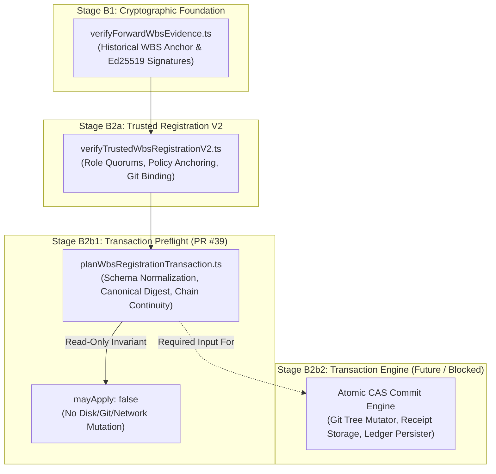

# PR #39 Independent Architecture Assessment

**Repository:** `Jeruzael/docmonstakrakin`  
**Target Pull Request:** PR #39 (`fix/pr38-postmerge-preflight-canonicalization-20261016`)  
**Evaluated HEAD Commit:** `e6108cbfda34e3262cdc5aa72868f79c507a1551` (previously `9a7b52fac6d0df4c9e5536c07cfd831641ff7ec7`)  
**Master Baseline:** `dfa1e170c5aae6e12824e7d75fcab53baa38fe17` (ordinary two-parent merge commit)  
**Assessment Date:** 2026-10-17  
**Mode:** Independent Read-Only Architecture Review  
**Architecture Verdict:** PASS (Clean Architectural Footprint; Verified Byte Identity; Historical Invariants Preserved)

---

## 1. Architectural Footprint & Git Diff Analysis

PR #39 is a tightly scoped corrective PR designed to remediate the premature merge of PR #38 without introducing unverified architectural dependencies or mutating historical governance state.

A diff between PR #39 HEAD (`e6108cbfda34e3262cdc5aa72868f79c507a1551`) and its base `origin/master` (`dfa1e170c5aae6e12824e7d75fcab53baa38fe17`) confirms that **exactly 4 files** are affected:

```
M  docs/06_planning/WBS_REGISTRATION_TRANSACTION_PREFLIGHT_B2B1.md
A  docs/07_verification/PR38_PREMATURE_MERGE_CORRECTIVE_ACTION.md
M  scripts/planWbsRegistrationTransaction.ts
M  scripts/testPlanWbsRegistrationTransaction.ts
```

### Git Blob Object Identity Verification
To verify that PR #39 contains the exact remediated implementation without unreviewed modifications, Git blob hashes in PR #39 were compared against the verified remediation commit (`3f4cf5c7eff5dd051b9c1dfa7b11ffaae4ef5fe0`):

| File Path | PR #39 Blob SHA | Remediation Blob SHA (`3f4cf5c`) | Match Status |
|---|---|---|---|
| `scripts/planWbsRegistrationTransaction.ts` | `c87cbcce5b3c4f71fb3cb1d8f52c60b39278c6bf` | `c87cbcce5b3c4f71fb3cb1d8f52c60b39278c6bf` | **EXACT MATCH (Byte Identical)** |
| `scripts/testPlanWbsRegistrationTransaction.ts` | `a30cf9206e8e705bc64dd99b864d18e21b264373` | `a30cf9206e8e705bc64dd99b864d18e21b264373` | **EXACT MATCH (Byte Identical)** |
| `docs/06_planning/WBS_REGISTRATION_TRANSACTION_PREFLIGHT_B2B1.md` | `fe121369ea2d744ff5252522194f26a681e4507f` | `fe121369ea2d744ff5252522194f26a681e4507f` | **EXACT MATCH (Byte Identical)** |
| `docs/07_verification/PR38_PREMATURE_MERGE_CORRECTIVE_ACTION.md` | `55ffaae4e32049e0c52bbdf5b306e00ec270ee06` | N/A (Governance corrective record) | **CORRECTED GOVERNANCE RECORD** |

This verifies that PR #39 cleanly forward-ports the exact reviewed preflight hardening without code drift or unintended alterations.

---

## 2. Historical Baseline & State Preservation

A core architectural invariant of the DOCMONSTAKRAKIN governance framework is that feature additions and corrective patches must never alter historical governance evidence, canonical WBS registries, or runtime project state without dedicated authorization.

### Audit of Protected Paths
1. **Canonical WBS Registries:**
   - `docs/00_control/` (including all canonical WBS manifests) remains completely unmodified.
   - `docs/07_verification/historical-wbs/` (including `DMK_197_POST_CLOSURE_MASTER_WBS.yaml` and `DMK_196_POST_CLOSURE_MASTER_WBS.yaml`) remains unmodified.
2. **Historical Governance Verifiers:**
   - All historical verification scripts were executed locally in the detached review worktree and passed unconditionally (exit code 0):
     - `verifyDmk196Closure.ts`: **PASS**
     - `verifyDmk197Closure.ts`: **PASS**
     - `verifyDmk208StatusAudit.ts`: **PASS**
     - `testDmk197PostMergeGovernance.ts`: **PASS**
3. **Runtime & Configuration State:**
   - `.local/project-state.json` was not modified (`85f42cf5949722092bc576edce9c1d392673fb30ceca82d13c004b96f73d0bb3`).
   - `package.json` and `package-lock.json` were not modified.
   - GitHub Actions workflow files in `.github/workflows/` were not modified.

---

## 3. Review of Governance Deviation Documentation

PR #39 adds [`docs/07_verification/PR38_PREMATURE_MERGE_CORRECTIVE_ACTION.md`](./PR38_PREMATURE_MERGE_CORRECTIVE_ACTION.md) to formally document the out-of-band merge event on `master`.

### Governance Corrections Applied (Commit `e6108cbfda34e3262cdc5aa72868f79c507a1551`)
The governance record was updated to incorporate three required corrections:
- **Correction A — Merge Type:** Corrected from "squash merge" to "ordinary Git merge commit with two parents (`ab6c1da2731da3290ee7f52fccf8272fc2f031ae` and `75e9dfb9dfafa2a65bf8954ca697be80624f37a5`)". Original merge SHA: `dfa1e170c5aae6e12824e7d75fcab53baa38fe17`. Verified GitHub timestamp (`2026-10-16T01:41:19Z`) and actor (`Jeruzael`) preserved.
- **Correction B — Corrective PR Identification:** Replaced the placeholder with exact link `https://github.com/Jeruzael/docmonstakrakin/pull/39`, recording initial reviewed HEAD `9a7b52fac6d0df4c9e5536c07cfd831641ff7ec7` and initial CI Run `38910028915` (all 3 jobs SUCCESS; 62/62 suites, 1,440/1,440 assertions).
- **Correction C — Governance Status:** Retained `PREMATURE_MERGE / CORRECTIVE_ACTION_PENDING / HUMAN_GOVERNANCE_PENDING`. Explicitly affirms that green CI and corrective PR preparation do not retrospectively authorize the original merge.

---

## 4. Architectural Boundaries & System Layering

### 4.1 System Layering Overview

The cryptographic governance architecture of DOCMONSTAKRAKIN is layered sequentially:



### 4.2 Boundary Invariants
1. **Separation of Planning from Execution:**
   - PR #39 implements **Stage B2b1 only** (the read-only transaction preflight planning).
   - It validates whether a proposed receipt and new WBS could be validly committed against current ledger state, computing exact byte representations (`proposedLedgerBytes`, `proposedLedgerSha256`, `signedReceiptDigestV2`).
   - It explicitly refrains from performing the registration. It contains **no commit logic**, **no file writing**, and **no branch updating**.
2. **Deterministic Canonical Hashing Contract:**
   - The contract defined in `WBS_REGISTRATION_TRANSACTION_PREFLIGHT_B2B1.md` establishes a stable versioned hashing algorithm (`signedReceiptDigestV2`).
   - Any external system (e.g. human signers, CI auditors, or future write engines) implementing the specification will produce byte-identical digests for identical logical approval intents.

---

## 5. Architectural Verdict

- **Verdict:** **PASS**.
- PR #39 maintains architectural purity, adheres strictly to project separation-of-concerns guidelines, introduces no regressive side effects, and preserves all historical verification baselines.
- The branch is structurally and architecturally ready for integration into `master`, subject to human governance review.
